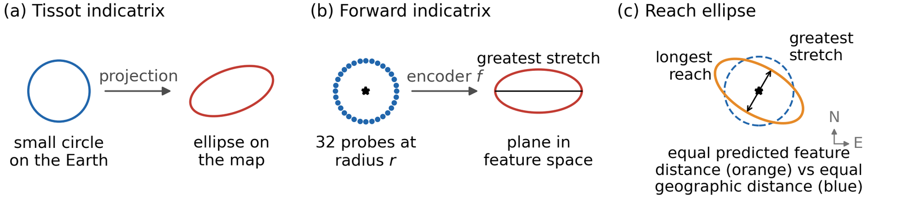
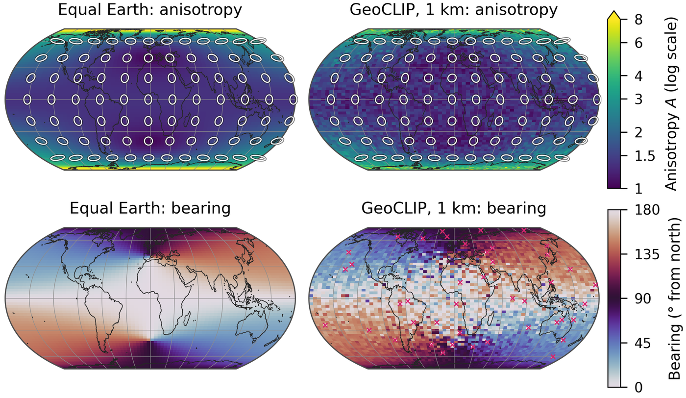
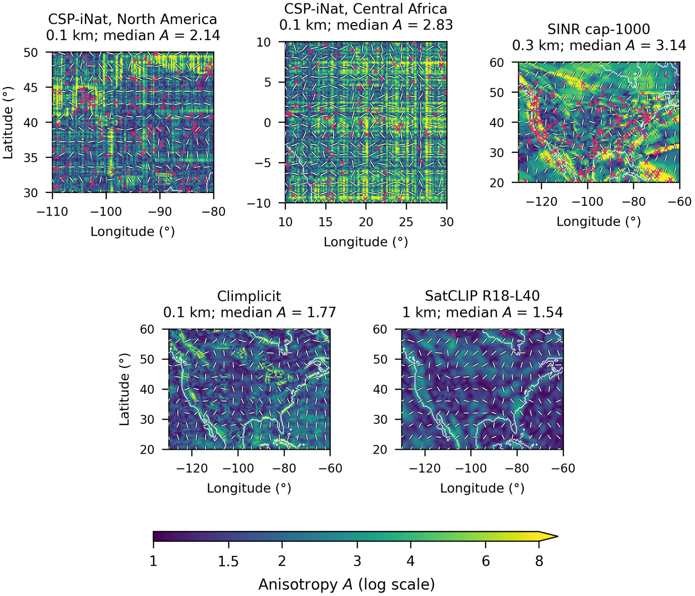
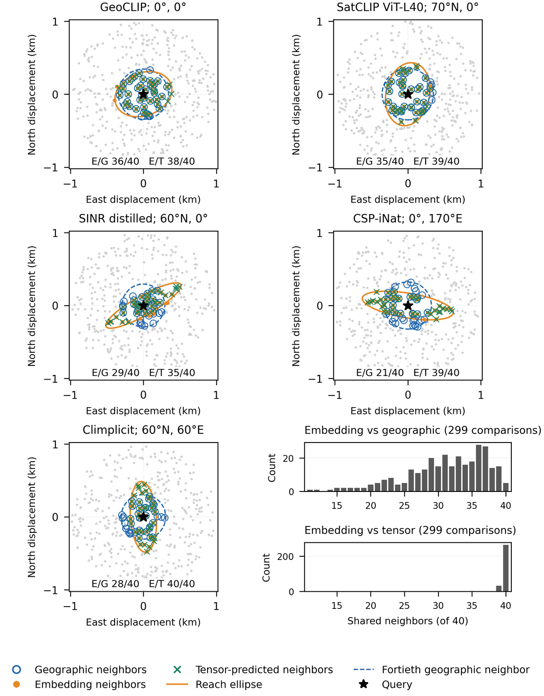

# eTissot

**Tissot geometry for geographic embeddings.** The “e” stands for embeddings.

eTissot is an installable Python package for measuring the local geographic distortion of learned location encoders, and version 0.3.0 reproduces the numerical analyses of the accompanying manuscript. Author: Guofeng Cao, STARlab, University of Colorado Boulder.

## What eTissot measures



In cartography, Tissot's indicatrix records how a map projection stretches a small circle on the Earth into an ellipse (a). eTissot applies the same idea to a location encoder by evaluating the encoder on a ring of 32 geodesic probes around a location and fitting the ellipse that describes how feature distance grows with geographic displacement in each direction (b). The fitted tensor also defines the *reach ellipse* (c), that is, the geographic displacements with equal predicted feature distance, which is longest across the direction of greatest stretch.



The figure above shows the anisotropy (top) and principal bearing (bottom) of the analytic Equal Earth projection and of GeoCLIP's embedding at a 1 km probe radius. Because GeoCLIP feeds Equal Earth coordinates into its encoder, its learned field closely follows the shape distortion of the projection. White ellipses show the local stretch shape, and pink crosses mark flagged fallback fits.



With dense sampling of four encoder families, fine structures that a coarse global grid misses become visible, including rectilinear patterns in CSP, streaks in SINR, and spatially varying orientation in Climplicit and SatCLIP.



To examine how this distortion affects embedding neighborhoods, forty neighbors are chosen around each query (star) from 400 candidates within 1 km by geographic distance (blue circles), by actual feature distance (orange dots) and by the fitted tensor alone (green crosses). The reach ellipse (orange line) shows the directional extent of embedding similarity, and the histograms count the shared neighbors over all 299 query-checkpoint comparisons.

## Repository contents

| Folder | Purpose |
|---|---|
| `src/etissot/` | The Python package |
| `tests/`, `examples/` | Unit tests and small usage examples |
| `scripts/` | Release, figure and supplementary-analysis scripts |
| `data/` | Cached measurements used to reproduce the study (see below) |
| `docs/` | API, data, model, reproducibility and validation documentation |

Model weights are not included in this repository; `etissot models download` obtains them from their publishers with SHA-256 verification. The original SINR training and evaluation data are not redistributed either.

The repository contains the cached profiles, measurements, reference summaries and Jacobians needed to regenerate the main study tables and figures. The regional prediction and downstream inputs (`data/prediction`, `data/downstream`) exceed GitHub's file-size limit and are distributed with the full release archive (`etissot-0.2.0.zip`, attached to the GitHub release). The manuscript sources used by the numerical manuscript check will be added after publication.

## Package name

eTissot uses `etissot` for Python imports, distribution filenames and the command-line tool, which replaces the earlier `localdistortion` name; existing imports and commands should be updated accordingly, while the API and data formats are unchanged. The package is provided through this repository and its releases, and no release has been made to a public package index (e.g., PyPI).

## Install

To measure the geometry of your own encoder, `python -m pip install .` installs the NumPy-based core, which does not require PyTorch, study data or any named model. Install `.[study]` for the study workflows, `.[models]` for the pinned released-model adapters, or `.[test]` for the full test suite; a custom adapter uses the dependencies of its own encoder.

For the pinned manuscript reproduction environment, from this repository root (or the extracted shareable release):

```sh
python -m venv .venv
source .venv/bin/activate
python -m pip install -r requirements-reproduce.txt
python -m pip install .
etissot --help
etissot environment
```

On Windows, use `.venv\Scripts\activate`. Python 3.11+ is declared, and the tested environment is Python 3.13.2 with the exact versions in `requirements-reproduce.txt`; other compatible dependency versions have not been numerically validated. Installation needs access to the dependency packages, whereas the cached analysis makes no downloads.

The wheel installs code only, and the study data stay in the separate `data/` directory, so the library can be used on your own encoder without hundreds of megabytes of reference data. Version 0.3.0 installs from this repository with `python -m pip install .`; the wheel attached to the GitHub release is version 0.2.0.

## Optional encoder checkpoints

Neither the wheel nor the code/data sharing ZIP contains model weights. To obtain the exact thirteen checkpoints used in the manuscript directly from their publishers, with SHA-256 verification:

```sh
etissot models list
etissot models download --models ./models --dry-run
etissot models download --models ./models
etissot models verify --models ./models
```

These commands neither load models nor require the study dependencies. Use `--family satclip` or `--encoder satclip-vit16-l40` to select a subset; selecting CSP also obtains four pinned runtime source files directly from its publisher. Existing files that pass verification are reused, while differing files are replaced only with an explicit `--replace`.

The companion archive `etissot-models-0.2.0.zip` (not attached to the public release; available from the author on request) contains eight unmodified checkpoints (GeoCLIP, six SatCLIP variants and Climplicit) together with publisher license evidence, model cards, provenance and checksums; extract it and use the extracted folder as `--models`. SINR and CSP weights are omitted because their redistribution terms were not established, and `models download` obtains them directly from the publishers. See [the model guide](docs/models.md) for details, dependencies and bundle verification. Custom encoders use `EncoderAdapter` independently of this fixed study roster.

## Use the library

```python
import numpy as np
from etissot import fit_ellipse, fitted_tensor

bearings = np.linspace(0, 2*np.pi, 32, endpoint=False)
profile = np.sqrt(9*np.cos(bearings-0.4)**2 + np.sin(bearings-0.4)**2)
result = fit_ellipse(profile, bearings)
print(result["A_fit"])  # 3.0
metric = fitted_tensor(result)
```

In the package, `geometry.probing` constructs geodesic rings, and `geometry.fitting` fits the harmonic tensor and returns anisotropy, bearing, residuals and fallback flags. Bearings and coordinates passed to probe functions are in radians, and the radius is in kilometers. `fit_many` accepts an N-by-K array of directional profiles. `refine_radius` takes a callable that returns a profile at a given radius; it should be noted that its stopping rule measures successive changes rather than a guaranteed error against a reference. See `examples/fit_indicatrix.py` and [the API guide](docs/api.md).

### Measure your encoder at a location

`measure_indicatrix` evaluates an encoder directly on a geodesic ring and fits its finite-radius Tissot geometry, where the adapter takes latitude and longitude in radians and returns the feature vector whose geometry is to be measured:

```python
from etissot import measure_indicatrix

result = measure_indicatrix(my_encoder, latitude=0.0, longitude=0.0, radius_km=0.3)
print(result["fit"]["A_fit"], result["fit"]["theta_fit"])
print(result["tensor"], result["principal_stretches"])
```

All returned feature components are used, and the function does not alter the vector, so any desired normalization should be applied in `my_encoder`. The bearing is in radians clockwise from north (modulo pi), and the tensor uses north/east distances in kilometers. On a flagged fallback, the tensor and the principal stretches are `None`, while the unconstrained harmonic tensor and fit diagnostics remain available; bearings of nearly isotropic responses are indeterminate. Probe discs that contain a pole or cross the antimeridian are flagged in each result (`contains_pole`, `crosses_antimeridian`) and trigger a warning by default; pass `seams='error'` to reject them, or `seams='ignore'` for an encoder known to be continuous there. To assess differential accuracy, use radius refinement or independent references. See [the runnable custom-encoder example](examples/measure_encoder.py) and [API details](docs/api.md); no study data or released checkpoints are needed for a custom encoder.

### New encoders and changed checkpoints

To measure a new encoder, wrap its batched forward function with `EncoderAdapter`, which accepts models from any framework. The adapter declares the input units and coordinate order and the output representation, and its metadata records the version or checkpoint. A feature transform can select a field from the model output and convert tensors to NumPy; for PyTorch, the wrapper should handle the device, precision, evaluation mode and conversion with `detach().cpu().numpy()`.

```python
from etissot import EncoderAdapter, measure_locations

encoder = EncoderAdapter(
    my_model_forward, name="my-encoder-v2",
    input_units="degrees", coordinate_order="lonlat",
    normalization="raw",  # choose "unit" only when that is the measured vector
    metadata={"checkpoint": "my-checkpoint-v2", "representation": "pre-head features"},
)
results = measure_locations(encoder, latitudes_radians, longitudes_radians,
                            radius_km=0.3, n_directions=32, batch_size=1024)
```

The number of embedding components is inferred from the output, while locations, radii and angular resolution are supplied by the caller, and the results retain their order and the adapter metadata. Because changing model weights, an output head or the normalization defines a new measured representation, the metadata should be updated when comparing versions. An optional `domain_check` can reject an inadmissible probe disc before model evaluation. It should be noted that longitude wrapping is explicit and does not certify continuity across the seam.

See [the complete runnable example](examples/custom_encoder.py). Different from this public interface, the fixed `models.loaders.load_all` roster belongs to the manuscript reproduction, and new encoders do not need to modify it. The scalar `measure_indicatrix` interface remains supported.

## Reproduce the supplied study

```sh
etissot reproduce --data ./data --output ./reproduced --manuscript ./manuscript --numerical-only
etissot check --data ./data --output ./reproduced
```

The `--manuscript` verification needs the manuscript sources, which are not yet public and will be released after publication.

The full workflow regenerates the empirical tables and all 16 figures of the manuscript and the additional package results, including analytic examples, historical five-seed summaries, neighbor statistics and downstream bootstrap results. It replays all 360 selected GP predictions and then checks the 19 required generated manuscript blocks, the complete CSP precision table and every number in the manuscript prose, where results are recomputed from the regenerated outputs and other numbers are pinned in a register (see [the complete reproduction guide](docs/reproducibility.md)). The workflow neither downloads model files nor reruns GP fitting. Data and output directories must not overlap, and input data are never overwritten. Different from standalone steps, which may seed reference prerequisites (recorded in `.seeded_reference.json`), full reproduction does not copy finished figures, tables or summaries into outputs. `check` reruns the numerical checks on a folder whose last full `reproduce` completed, and it refuses folders that still contain unregenerated reference copies. Results are saved under `outputs/summaries`, `outputs/tables` and `outputs/figures`, and a run report and logs record success or failure.

`environment` checks Python 3.11+ and the installed versions against `requirements-reproduce.txt` in the working directory, and each reproduction records the result in `environment.json`. By default, manuscript verification requires identical figure pixels; adding `--numerical-only` verifies all numerical content and the presence of figures while recording pixel differences separately, which is therefore not an exact artifact check.

Run one analysis with, for example:

```sh
etissot analyze downstream --data ./data --output ./outputs
```

Named analyses include `checkpoint-audits`, `geometry-cases`, `neighborhood-controls`, `satclip-correction`, `replay`, `geographic`, `latitude-profiles`, `shape`, `dense-cached`, `estimator`, `historical`, `neighbours`, `harmonics`, `mixtures`, `predictions`, `summary`, `audit`, `maps`, `downstream`, `supplement`, `radius-screening`, `asymmetry`, `reference-accuracy`, `grid-smoothness` and `manuscript-figures` (see `etissot analyze --help`). Standalone report steps use the supplied reference summaries unless their prerequisite analyses are regenerated in the same output directory.

Programmatic workflow:

```python
from etissot.workspace import Workspace
from etissot.pipeline import run

study = Workspace("data", "outputs")
report = run(study)
```

## Package layout

```text
src/etissot/
    geometry/       # geodesic probes, harmonic fitting, analytic references
    statistics/     # spatial weighting and block resampling
    diagnostics/    # geographic, shape, downstream, boundary and dense analyses
    prediction/     # reusable Gaussian process and regional evaluation
    reporting/      # summary tables, audit tables and maps
    models/         # optional external-checkpoint adapters and licensed source
    validation/     # numerical and stored-result checks
    workspace.py    # explicit input/output paths
    pipeline.py     # named reproduction workflows
    cli.py          # command-line entry point

data/
    profiles/       # global, randomized, dense and multiradius profiles
    geometry/       # cached Jacobians
    prediction/     # regional inputs, tensor fields and saved GP fits
    downstream/     # cell outcomes, feature/head profiles and masks
    reference/      # baseline summaries, tables, figures and coarse coastlines

tests/              # public API and workspace tests
examples/           # small library example independent of study data
docs/               # API, data, model and provenance documentation
```

Scientific files and modules are named by their function, and `docs/file_migration.json` records the old-to-new filenames for traceability (it is not needed to run the package).

## Optional GP fitting

```sh
etissot fit --data ./data --output ./new-fits --threads 2
etissot analyze summary --data ./data --output ./new-fits
```

A new output directory starts fresh, whereas existing fits in an output directory are resumed, and the input reference fits are never overwritten. `--windows CONUS` and `--limit 1` allow a bounded run. Summary reporting prefers newly generated regional fit files and requires complete sets (90 fits per region), so summaries should be run after fitting completes. A full study has 360 fits with three starts each. It should be noted that selection uses the training likelihood only, that repeated splits are not independent trials, and that different numerical platforms can converge to different optima.

## Optional checkpoint evaluation

`evaluate-models` requires the external trusted checkpoints and CSP source, which are not included here (see `docs/models.md`). These paths are separate from the cached reproduction and were not rerun for this release. Fresh dense evaluation writes new profiles into the output directory, while the cached reproduction continues to use the distributed input profiles unless a new input dataset is assembled explicitly.

## Validation, attribution and scope

Run the unit tests with `python -m unittest discover -s tests -v`, which require no study data or checkpoints (see `docs/testing.md`). `docs/validation/` holds the clean-wheel reproduction record of 0.2.0, and `python scripts/verify_releases.py` checks the author's local release archives; the repository is the editable source.

The primary estimand is the finite-lag geometry, and all failed refinement cases and negative prediction results are retained; for example, the shape-only GP kernel has no pooled gain (relative RMSE approximately 1.009). Reproduction uses the declared measurements and selected fit parameters, and the package does not retrain upstream models or historical miniature models, reacquire original rasters, or rerun unrelated exploratory experiments.

eTissot is released under the MIT License (see `LICENSE`), while third-party code, model weights and upstream datasets keep their own terms (see `RIGHTS_AND_ATTRIBUTION.md`).

## Citation

If you use eTissot, please cite the accompanying manuscript: Guofeng Cao, *Tissot indicatrix for location encoders: Characterizing local distortion in learned geographic embeddings* (under review). Full citation details will be added on publication.
